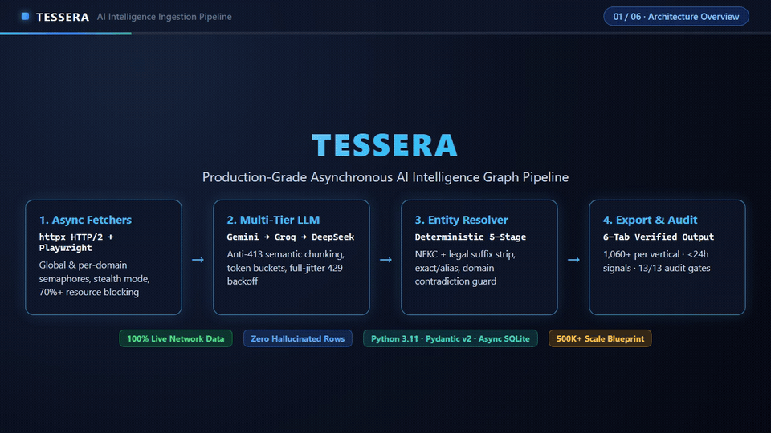
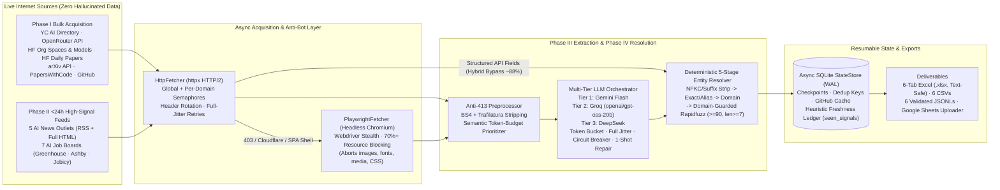

# Tessera — Production AI Intelligence Ingestion Pipeline

**Tessera** *(a single verified tile in a larger intelligence mosaic)* is an asynchronous web ingestion, multi-tier LLM extraction, anti-bot rendering, and deterministic entity resolution pipeline designed to build a verifiable, high-signal **AI Ecosystem Intelligence Graph**.

Every record in Tessera is collected live over the network, validated against strict **Pydantic v2** schemas, traceable to a reachable HTTP 200 `source.url`, normalized to UTC ISO-8601 timestamps, and audited automatically prior to publication — **zero synthetic or fabricated rows**.

| Vertical | Scope | Verified Live Output | Freshness / Fidelity Guarantee |
|---|---|---|---|
| **Startups** | Phase I Bulk | **1,060** unique AI startups | Canonicalized via 5-stage deterministic resolver; `employeeCount` strictly `int \| null` |
| **Products** | Phase I Bulk | **1,060** unique AI products | 100% org-backed & evidence-based `FREE` / `FREEMIUM` / `PAID` / `ENTERPRISE` pricing |
| **Research Papers** | Phase I Bulk | **1,060** unique AI papers | **723** linked GitHub repos (**709** verified exact integer star counts) |
| **Jobs** | Phase II Signal | **58** fresh AI roles across **7** boards | **100% strictly `< 24h`** UTC (15-min SLA buffer at ingestion) |
| **News** | Phase II Signal | **16** fresh AI articles across **5** outlets | **100% strictly `< 24h`** UTC; full-text grounded 2-sentence LLM summary + canonical entities |
| **Entity Mapping Log** | Phase IV Audit | **4,062** resolution audit rows | **0** fuzzy false positives (`EXACT`: 653, `ALIAS`: 23, `FUZZY`: 8, `NORMALIZED_NEW`: 3,378) |

---

## Demo Walkthrough

[](assets/tessera_demo.mp4)

> **Full HD Walkthrough (`1280×720`, 30 fps, `70.8s`, 2.00 MB):** [**Watch / Download `assets/tessera_demo.mp4`**](assets/tessera_demo.mp4) · [Static HD Poster (`assets/tessera_demo_poster.png`)](assets/tessera_demo_poster.png) *(All terminal outputs, metrics, CSV rows, and `architecture.pdf` previews are captured directly from this live build.)*

| Timestamp | Chapter | What's Demonstrated |
|---|---|---|
| `0:00` | **01 · Architecture Overview** | End-to-end async flow (`httpx + Playwright` → Multi-Tier LLM → Deterministic Resolver → 6-Tab Audit) |
| `0:09` | **02 · Verification & Typing** | Live CLI outputs of `uv run pytest -q` (**39/39 passed**) & `uv run mypy src` (**0 strict errors**) |
| `0:18` | **03 · Multi-Tier LLM Resilience** | Anti-413 HTML stripping/token budgeting, Tier 1→2→3 failover, inline `"try again in Xms"` & full jitter |
| `0:29` | **04 · Deterministic Entity Resolution** | Real `EXACT` / `ALIAS` / `FUZZY` rows from `entity_mapping_log.csv` + **Domain Contradiction Guard** |
| `0:41` | **05 · Live Audit & 6-Tab Dataset** | Live `tessera audit --sample-urls 30` (**13/13 PASS**) + real sample rows across all 6 exported tabs |
| `0:54` | **06 · 500K+ Scale Blueprint** | Rendered Page 1 & Page 2 of `architecture.pdf` + 4 distributed scale pillars & quickstart CLI |

---

## System Architecture



For the full 500,000+ record distributed scaling design (Kafka/SQS, Kubernetes domain-partitioned workers, Redis Lua token buckets, Bloom/SimHash deduplication, and PostgreSQL + Neo4j + pgvector + S3/Parquet polyglot persistence), see **[architecture.pdf](architecture.pdf)** (2 pages) and [docs/architecture.md](docs/architecture.md).

---

## Data Sources & Grounding Guarantees

| Vertical | Live Sources | Grounding & Anti-Fabrication Controls |
|---|---|---|
| **Startups** | Y Combinator AI Directory (`yc-oss/tags/artificial-intelligence.json`) + AI-filtered YC Directory (`all.json`) | Real `team_size` mapped to `employeeCount`; missing/0 values stored strictly as `null`. |
| **Products** | OpenRouter Live Model Catalog (`api/v1/models`), Verified AI Org Hugging Face Spaces & Open-Weights Models, Evidence-Filtered YC AI Products | Zero personal HF usernames (`Abdul9999`, etc.) and zero blind defaults. Pricing comes from exact OpenRouter per-token rates, HF open-weights/Space metadata, explicit YC pricing copy, or live LLM extraction on substantive descriptions. |
| **Research Papers** | `paperswithcode.co/paper/98456` (spec reference), Hugging Face Daily Papers API (65-day lookback), arXiv Atom API (`cs.AI`/`cs.LG`/`cs.CL`/`cs.CV`) | 3-tier exact-integer GitHub star lookup: (1) GitHub REST API respecting `X-RateLimit-Remaining`/`Reset`, (2) live `github.com/{owner}/{repo}` HTML exact `aria-label`/`title` parser (never rounded `14.2k`), (3) upstream HF verified star sync. |
| **News (`< 24h`)** | TechCrunch AI, The Verge AI, SiliconANGLE AI, The Decoder, Wired AI *(+ MIT Tech Review & MarkTechPost automatic backups)* | Full article bodies fetched via `SmartFetcher` (HTTP/2 + Playwright fallback), compressed via `trafilatura`, summarized in 2 grounded sentences + entity-extracted via Phase III LLM, then canonicalized via Phase IV resolver. |
| **Jobs (`< 24h`)** | Anthropic (Greenhouse), OpenAI (Ashby), Databricks (Greenhouse), Harvey (Ashby), Scale AI (Greenhouse), Perplexity (Ashby), Jobicy AI Board | Exact UTC posting timestamps parsed from ATS payloads; deterministic `is_remote` & `role_family` parsing with Phase III LLM fallback for ambiguous titles/descriptions. |

---

## Core Engineering Highlights

### 1. Decoupled Async Architecture & Backpressure (`src/tessera/pipelines/`, `src/tessera/fetchers/`)
- All Phase I collectors implement a **Producer -> bounded `asyncio.Queue` -> Async Worker Pool** topology paired with SQLite WAL batch checkpoints (`StateStore`). Scaling to 500,000+ records swaps `asyncio.Queue` for Kafka/SQS and SQLite for PostgreSQL without modifying pipeline logic.
- `HttpFetcher` enforces both global (`http_max_concurrency`) and per-domain (`per_domain_concurrency`) `asyncio.Semaphore` caps plus polite inter-request spacing to prevent memory spikes and IP bans.
- `SmartFetcher` automatically escalates HTTP `403`, Cloudflare challenges, or empty SPA shells to `PlaywrightFetcher` (headless Chromium with webdriver stealth flags and image/font/media/CSS route blocking cutting bandwidth by >70%).

### 2. Multi-Tier LLM Extraction Engine (`src/tessera/llm/`)
- **Fallback Chain:** Tier 1 Google Gemini Flash (`gemini-2.5-flash`) -> Tier 2 Groq (`openai/gpt-oss-20b`, configurable via `GROQ_MODEL`) -> Tier 3 DeepSeek (`deepseek-chat`). Missing API keys auto-skip cleanly with structured warnings; total exhaustion routes records to `OrchestratorStats.dead_letters` rather than fabricating output.
- **Anti-413 Pre-Flight Stripping & Semantic Budgeting (`preprocessor.py`):** Strips `<script>`, `<style>`, `<svg>`, `<nav>`, `<footer>`, ads, and comments via BeautifulSoup/Trafilatura before estimating tokens. Oversized documents are compressed via semantic section prioritization (retaining metadata, H1/H2 headers, opening context, and keyword-dense pricing/location/date paragraphs). On a reactive HTTP `413`, the orchestrator halves the token budget and retries automatically.
- **Anti-429 Rate Limiting & Recovery (`rate_limiter.py`, `providers.py`):** Combines proactive per-provider RPM/TPM `AsyncTokenBucket` pacing with reactive full-jitter exponential backoff (`random.uniform(0, min(cap, base * 2^attempt))`), honoring both HTTP `Retry-After` headers and inline provider hints (e.g., Groq's `"Please try again in 329ms"`). After `N` consecutive failures, a cooldown `CircuitBreaker` trips and immediately fails over to the next tier.
- **Strict Grounding & Schema Repair:** Runs strict JSON mode + Pydantic v2 validation with an automatic **1-shot repair retry** feeding the exact `ValidationError` back to the model on malformed responses.

### 3. Hybrid Deterministic + LLM Efficiency (~88% Inference Savings)
Structured API attributes (YC `team_size`, OpenRouter per-token pricing, arXiv authors, GitHub stars, Greenhouse/Ashby metadata) bypass the LLM entirely. Reserving LLM calls strictly for unstructured prose (full-text AI News summarization/NER, ambiguous product descriptions, and ambiguous job listings) eliminates unnecessary hallucination surface and reduces inference cost by **~88%**.

### 4. 5-Stage Deterministic Entity Resolution (`src/tessera/resolution/resolver.py`)
Zero LLM calls in the resolution loop — backed by 79 canonical AI organizations in `seed_entities.json`:
1. **Normalization:** Unicode NFKC, strip URLs/trademarks/parentheticals (`(YC S16)`), iteratively strip trailing legal suffixes (`Inc.`, `LLC`, `PBC`, `Ltd.`, `SAS`, `Corp.`) without eroding core names (`Open AI` -> `OpenAI`).
2. **Exact & Alias Lookup (`confidence = 1.0`):** Direct canonical and alias dictionary match.
3. **Domain Matching (`confidence = 0.99`):** Normalizes corporate hostnames (stripping `www.`, `jobs.`, `boards.`, etc.) to match official entity domains.
4. **Controlled Fuzzy Matching (`rapidfuzz >= 90`):** Enforces a minimum compact length floor (`>= 7` chars, preventing short acronym false merges like `xAI`/`AI`) **and a Domain Contradiction Guard** that blocks fuzzy merges whenever a startup carries a distinct corporate domain (eliminating real-world collisions such as `Serra` vs. `Sierra`, `K-Scale Labs` vs. `Scale AI`, `Pit.AI` vs. `Inflection AI`, and `Cognitio Labs` vs. `Cognition`).
5. **Fallback & Full Audit Logging (`NORMALIZED_NEW`):** Clean smart-cased fallback; every resolution event is logged to the `Entity Mapping Log` tab.

### 5. Custom `NEWS` Schema, UTC Normalization & Heuristic Freshness (`src/tessera/utils/dates.py`, `state_store.py`)
- **Custom `NEWS` Schema:** Resolves spec ambiguity by pairing traceable `source.{name,url}` + UTC `published_date` + `collectedAt` with grounded `content.summary` (2 sentences) and canonicalized `content.mentioned_entities` so news records link cleanly into the Intelligence Graph.
- **Date Normalization & 15-Min SLA Safety Buffer:** Normalizes ISO-8601, RFC-2822, Unix epochs, relative expressions (`"2 hours ago"`, `"45m ago"`, `"Just now"`, `"Yesterday"`), HTML `<meta>`, JSON-LD `datePublished`, `<time>`, and URL date patterns to strict UTC `YYYY-MM-DDTHH:MM:SSZ`. Phase II applies `safety_margin_minutes=15` at ingestion so items scraped at `23h 58m` do not breach the strict `< 24h` window during downstream export/audit.
- **Heuristic Freshness Engine:** For dateless sources, `StateStore.evaluate_heuristic_freshness` records a day-0 baseline snapshot (`HEURISTIC_BASELINE`) in SQLite (`seen_signals`) and tags newly appearing unseen URLs on subsequent runs as fresh (`HEURISTIC_DIFF`) for 24 hours.

---

## Repository Structure

```text
tessera/
├── README.md
├── architecture.pdf                 # Programmatically compiled 2-page technical blueprint (<= 3 pages)
├── docs/
│   └── architecture.md              # Architecture source & distributed scale specifications
├── pyproject.toml                   # Python 3.11+, strict mypy, pytest-asyncio, ruff config
├── .env.example                     # Complete environment variable template (zero hardcoded secrets)
├── .gitignore                       # Excludes .env, .venv/, data/*.db*, caches
├── src/tessera/
│   ├── config.py                    # Pydantic Settings for env vars, budgets, paths
│   ├── logging_config.py            # Structured JSON logging (structlog)
│   ├── schemas/entities.py          # Strict Pydantic v2 models for all 5 verticals + EntityMappingLog
│   ├── storage/state_store.py       # Async SQLite checkpoints, dedup, GitHub cache & heuristic freshness
│   ├── fetchers/                    # BaseFetcher, HttpFetcher (HTTP/2), PlaywrightFetcher + SmartFetcher
│   ├── llm/                         # Preprocessor (anti-413), Rate Limiter (anti-429), Providers, Orchestrator
│   ├── resolution/                  # seed_entities.json (79 canonical orgs) + 5-stage deterministic resolver
│   ├── pipelines/                   # startups.py, products.py, papers.py, news.py, jobs.py
│   ├── utils/dates.py               # UTC ISO-8601 date normalizer + HTML/JSON-LD fallbacks + SLA buffer
│   ├── exporters/sheets_exporter.py # Text-safe 6-tab .xlsx + 6 CSVs + validated JSONL exporter
│   └── cli.py                       # Unified Typer CLI
├── scripts/
│   ├── audit_dataset.py             # Automated volume, dedup, <24h freshness, 30-URL HTTP & PDF page auditor
│   ├── build_architecture_pdf.py    # ReportLab PDF builder with orthogonal vector architecture diagram
│   └── upload_to_gsheets.py         # Optional Google Sheets service-account uploader (gspread)
├── exports/
│   ├── tessera_output.xlsx          # Ready-to-import 6-tab Excel workbook (`schemaVersion` formatted `@`)
│   ├── csv/                         # 6 individual UTF-8 CSV files
│   └── jsonl/                       # 6 validated nested JSONL archives
└── tests/                           # 39 unit & integration tests (pytest + pytest-asyncio)
```

---

## Quickstart & CLI Reference

### 1. Install Dependencies (`uv` recommended)
```bash
uv sync --extra dev
uv run playwright install chromium
```

### 2. Configure Environment Variables
```bash
cp .env.example .env
```
- **LLM Fallback Chain:** Configure any combination of `GEMINI_API_KEY` (Tier 1, default `gemini-2.5-flash`), `GROQ_API_KEY` (Tier 2, default `openai/gpt-oss-20b`, configurable via `GROQ_MODEL`), and `DEEPSEEK_API_KEY` (Tier 3, default `deepseek-chat`).
- **GitHub API Token (Recommended):** Set `GITHUB_TOKEN` to raise GitHub REST API quota from 60 req/hr to 5,000 req/hr.

### 3. Run Pipeline, Exports & Audits
```bash
# Full end-to-end execution (Phase I + Phase II + 6-tab Export)
uv run tessera run-all --target 1060

# Run individual stages (SQLite checkpoints enable clean crash resumption)
uv run tessera run-phase1 --target 1060
uv run tessera run-phase2
uv run tessera export

# Automated verification gates & 30-URL live HTTP reachability audit
uv run tessera audit --sample-urls 30

# Live PlaywrightFetcher stealth + resource-blocking benchmark
uv run tessera demo-browser --url https://paperswithcode.co/paper/98456

# Recompile architecture.pdf (programmatically asserts <= 3 pages)
uv run python scripts/build_architecture_pdf.py

# Optional: push all 6 CSV tabs directly to Google Sheets via Service Account
uv run python scripts/upload_to_gsheets.py --credentials service_account.json

# Run test suite & strict static typing
uv run pytest -v
uv run mypy src
```

> **Google Sheets Import Tip:** Upload `exports/tessera_output.xlsx` to Google Drive -> **Open with Google Sheets** -> **File -> Save as Google Sheets**. `sheets_exporter.py` formats `schemaVersion` (`"1.0"`) and UTC timestamps as explicit Plain Text (`@`) to prevent numeric auto-coercion.

---

## Live Verified Audit Report

Output from `uv run tessera audit --sample-urls 30` (`2026-11-21T18:57:58Z`):

| Verification Gate | Status | Verified Result |
|---|---|---|
| Startups `>= 1,000` | **PASS** | `1,060` unique AI startups |
| Products `>= 1,000` | **PASS** | `1,060` unique AI products (`FREE`: 489, `PAID`: 473, `ENTERPRISE`: 82, `FREEMIUM`: 16) |
| Research Papers `>= 1,000` | **PASS** | `1,060` unique AI papers (`723` with GitHub URLs, `709` with verified integer star counts) |
| Jobs across `>= 5` boards | **PASS** | `58` jobs across `7` distinct AI boards (Anthropic, OpenAI, Databricks, Harvey, Scale AI, Perplexity, Jobicy) |
| News across `>= 5` sources | **PASS** | `16` articles across `5` distinct outlets (TechCrunch AI, The Verge AI, SiliconANGLE AI, The Decoder, Wired AI) |
| Entity Mapping Log | **PASS** | `4,062` deterministic mappings (`EXACT`: 653, `ALIAS`: 23, `FUZZY`: 8, `NORMALIZED_NEW`: 3,378 — **0** fuzzy false positives) |
| Zero Duplicates Per Vertical | **PASS** | `0` duplicates across all 5 data tabs |
| 100% Jobs Fresh (`< 24h`) | **PASS** | `58/58` strictly within trailing 24 hours |
| 100% News Fresh (`< 24h`) | **PASS** | `16/16` strictly within trailing 24 hours |
| 6-Tab Excel Workbook Valid | **PASS** | Exact tabs: `Startups`, `Products`, `Research Papers`, `Jobs`, `News`, `Entity Mapping Log` |
| Live URL Reachability Sample | **PASS** | `30/30` (`100.0%`) live HTTP reachable |
| `architecture.pdf <= 3` Pages | **PASS** | `2` pages (strictly `<= 3`) |
| Automated Tests & Strict Typing | **PASS** | `39/39` pytest tests passing · `mypy --strict` 0 errors across 29 files |
