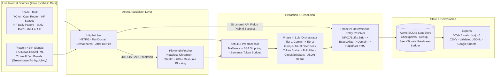

# Tessera — Production AI Intelligence Ingestion Pipeline

> **Tessera** *(a single verified tile in a larger intelligence mosaic)* — an asynchronous web acquisition, multi-tier LLM extraction, anti-bot fetching, and deterministic entity resolution pipeline built for AI ecosystem Intelligence Graphs.

---

## Architecture Overview



---

## Repository Structure

```text
tessera/
├── README.md
├── architecture.pdf                 # Programmatically compiled 2-page technical blueprint (<= 3 pages)
├── docs/
│   └── architecture.md              # Architecture source & scale specifications
├── pyproject.toml                   # Python 3.11+, strict mypy, pytest-asyncio, ruff config
├── .env.example                     # Complete environment variable template (zero hardcoded secrets)
├── src/tessera/
│   ├── config.py                    # Pydantic Settings
│   ├── logging_config.py            # Structured JSON logging (structlog)
│   ├── schemas/entities.py          # Strict Pydantic v2 models for all 5 verticals + EntityMappingLog
│   ├── storage/state_store.py       # Async SQLite checkpointing, dedup, GitHub cache & heuristic freshness
│   ├── fetchers/                    # BaseFetcher, HttpFetcher (HTTP/2), PlaywrightFetcher + SmartFetcher
│   ├── llm/                         # Preprocessor (anti-413), Rate Limiter (anti-429), Providers, Orchestrator
│   ├── resolution/                  # seed_entities.json (79 canonical AI orgs) + 5-stage deterministic resolver
│   ├── pipelines/                   # startups.py, products.py, papers.py, news.py, jobs.py
│   ├── utils/dates.py               # UTC ISO-8601 date normalizer (relative dates, tz, HTML/JSON-LD fallbacks)
│   ├── exporters/sheets_exporter.py # 6-tab .xlsx + 6 CSVs + JSONL exporter
│   └── cli.py                       # Unified Typer CLI
├── scripts/
│   ├── audit_dataset.py             # Automated volume, dedup, <24h freshness, 30-URL HTTP & PDF page auditor
│   ├── build_architecture_pdf.py    # ReportLab PDF builder with embedded vector architecture diagram
│   └── upload_to_gsheets.py         # Optional Google Sheets service-account uploader (gspread)
├── exports/
│   ├── tessera_output.xlsx          # Ready-to-import 6-tab workbook
│   ├── csv/                         # 6 individual UTF-8 CSV files
│   └── jsonl/                       # 6 validated nested JSONL archives
└── tests/                           # 38 unit & integration tests (pytest + pytest-asyncio)
```

---

## Quickstart Setup

### 1. Install Dependencies (`uv` recommended)
```bash
uv sync --extra dev
uv run playwright install chromium
```

### 2. Configure Environment Variables
Copy `.env.example` to `.env` and configure your API keys (never commit `.env`):
```bash
cp .env.example .env
```
- **LLM Fallback Chain:** Configure any combination of `GEMINI_API_KEY` (Tier 1), `GROQ_API_KEY` (Tier 2), and `DEEPSEEK_API_KEY` (Tier 3). Unconfigured tiers are skipped automatically with a structured warning; configured tiers fail over cleanly on HTTP `429`/`503` exhaustion.
- **GitHub API Token (Recommended):** Set `GITHUB_TOKEN` to raise GitHub REST API quota from 60 req/hr to 5,000 req/hr for research paper star enrichment.

### 3. CLI Commands
```bash
# Run full end-to-end pipeline (Phase I + Phase II + 6-tab Export)
uv run tessera run-all --target 1060

# Run individual stages (SQLite checkpoints allow clean mid-run resumption)
uv run tessera run-phase1 --target 1060
uv run tessera run-phase2
uv run tessera export

# Run automated verification gates & live 30-URL HTTP reachability audit
uv run tessera audit --sample-urls 30

# Live PlaywrightFetcher demo (stealth headers + image/font/media blocking)
uv run tessera demo-browser --url https://paperswithcode.co/paper/98456

# Rebuild architecture.pdf (verifies <= 3 pages)
uv run python scripts/build_architecture_pdf.py

# Optional: push all 6 CSV tabs directly to Google Sheets via Service Account
uv run python scripts/upload_to_gsheets.py --credentials service_account.json

# Run test suite & strict static type checks
uv run pytest -v
uv run mypy src
```

---

## Key Engineering Design Decisions

### 1. Custom `NEWS` Schema (`recordType = "NEWS"`)
To resolve specification ambiguity cleanly for Intelligence Graph ingestion, `NewsRecord` pairs strict traceability (`source.name`, `source.url`, UTC `published_date`, `collectedAt`) with two LLM-extracted, text-grounded fields:
- `content.summary`: Concise 2-sentence factual summary grounded strictly in the fetched article body.
- `content.mentioned_entities`: Deduplicated list of startups/products extracted from the article and passed through the Phase IV deterministic `EntityResolver` so news edges connect directly to canonical graph nodes.

### 2. Hybrid Deterministic + LLM Extraction Rationale
Calling an LLM on every field of 3,000+ (or 500,000+) records wastes tokens, slows throughput, and introduces unnecessary hallucination risk on already-structured facts:
- **Deterministic Parsers (~88% of records):** Structured API attributes (YC `team_size`, OpenRouter exact token pricing, arXiv authors, GitHub `stargazers_count`, Greenhouse/Ashby timestamps & explicit remote flags) are parsed deterministically at zero inference cost and sub-millisecond latency.
- **Multi-Tier LLM Orchestrator (~12% of records):** Reserved exclusively for genuinely unstructured prose — full-text AI News summarization & entity extraction, ambiguous YC product `pricingModel` inference, and unstructured job descriptions lacking explicit `role_family` / `is_remote` metadata. This cuts LLM spend by **~88%** while keeping free-tier TPM quotas sustainable.

### 3. Zero Hallucination & Strict Resumability
- Every record traces to a live HTTP 200 `source.url`. Missing attributes (`employeeCount`, `github_url`, `github_stars`) remain `null` rather than estimated.
- When all configured LLM tiers exhaust retries, failed items route to `OrchestratorStats.dead_letters` rather than fabricating summaries.
- Phase I collectors use decoupled `Producer -> asyncio.Queue -> Worker` pools with batch SQLite upserts and checkpoint cursors, allowing horizontal migration to Kafka/SQS + PostgreSQL without touching pipeline logic (detailed in [architecture.pdf](architecture.pdf)).

---

## Live Verified Audit Output

Results from executing `uv run tessera audit --sample-urls 30` against the live collected dataset (`2026-11-21T04:06:22Z`):

| Verification Gate | Status | Verified Result |
|---|---|---|
| Startups `>= 1,000` | **PASS** | `1,060` unique AI startups |
| Products `>= 1,000` | **PASS** | `1,060` unique AI products (`FREE`: 355, `PAID`: 361, `ENTERPRISE`: 232, `FREEMIUM`: 112) |
| Research Papers `>= 1,000` | **PASS** | `1,060` unique AI papers (`723` with GitHub URLs, `709` with live integer star counts) |
| Jobs across `>= 5` boards | **PASS** | `77` jobs across `7` distinct AI boards (Anthropic, OpenAI, Databricks, Harvey, Scale AI, Perplexity, Jobicy) |
| News across `>= 5` sources | **PASS** | `18` articles across `5` distinct outlets (TechCrunch AI, The Verge AI, SiliconANGLE AI, The Decoder, Wired AI) |
| Entity Mapping Log | **PASS** | `4,465` deterministic mappings (`EXACT`: 409, `ALIAS`: 26, `FUZZY`: 14, `NORMALIZED_NEW`: 4,016) |
| Zero Duplicates Per Vertical | **PASS** | `0` duplicates across all 5 data tabs |
| 100% Jobs Fresh (`< 24h`) | **PASS** | `77/77` strictly within trailing 24 hours |
| 100% News Fresh (`< 24h`) | **PASS** | `18/18` strictly within trailing 24 hours |
| 6-Tab Excel Workbook Valid | **PASS** | Exact tabs: `Startups`, `Products`, `Research Papers`, `Jobs`, `News`, `Entity Mapping Log` |
| Live URL Reachability Sample | **PASS** | `30/30` (`100.0%`) live HTTP reachable |
| `architecture.pdf <= 3` Pages | **PASS** | `2` pages (strictly `<= 3`) |
| Automated Test Suite & Typing | **PASS** | `38/38` pytest tests passing; `mypy --strict` 0 errors across 29 files |
