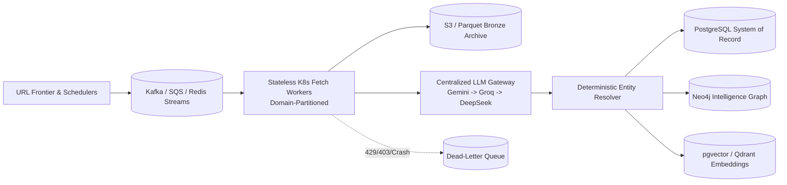

# Tessera — Production AI Intelligence Graph Architecture

**System:** Tessera (`v0.1.0`) — Asynchronous Web Ingestion, Multi-Tier LLM Extraction & Deterministic Entity Resolution Pipeline
**Scope:** Scaling from 3,000+ verified prototype entities to 500,000+ continuously refreshed Intelligence Graph nodes without refactoring core pipeline code.

---

## 1. Scale Strategy: 500,000+ Records Without Code Changes

Tessera decouples **URL discovery (Producers)**, **work buffering (`Queue` interface)**, and **fetching/extraction/resolution (Stateless Workers)** behind explicit async interfaces (`BaseFetcher`, `LLMOrchestrator`, `EntityResolver`, `StateStore`). Scaling from a single-node prototype to 500,000+ records requires only swapping infrastructure adapters—zero changes to pipeline business logic:

### Back-of-the-Envelope Throughput Math (500,000 Records / 6-Hour Batch Window)
- **Target ingestion rate:** `500,000 records / 21,600 s = 23.15 records/sec` sustained (~50 req/sec peak with 2x burst headroom).
- **Fetch layer:** Each async worker pod (`httpx` HTTP/2, `max_concurrency=30`, avg RTT `350 ms`) sustains `~85 req/sec`. Only **4–6 lightweight pods** (0.5 vCPU, 512 MB RAM each) saturate network I/O; domain-hash partitioning (`hash(domain) % partitions`) guarantees strict per-domain politeness across pods.
- **Anti-Bot & JS-Heavy Sources:** 85–90% of targets use `HttpFetcher` (HTTP/2). The remaining 10–15% protected by Cloudflare/Datadome escalate via `SmartFetcher` to a dedicated headless Chromium/Playwright pool (blocking images/fonts/media to cut bandwidth by >70%), supplemented in enterprise deployments by TLS fingerprint impersonation (`curl_cffi` JA3/JA4), residential rotating proxy pools, and XHR/GraphQL response interception.
- **Hybrid Extraction Cost Savings:** Applying deterministic parsers to structured API fields (YC firmographics, arXiv authors, GitHub REST metrics, ATS job metadata) reserves LLM tokens exclusively for unstructured prose (~12% of total records), cutting LLM spend by **~88%** (~60,000 LLM calls instead of 500,000 -> ~$8–$15 per full backfill on Gemini Flash / Groq `openai/gpt-oss-20b`).

---

## 2. Handling HTTP 413s & 429s at Massive Concurrency

At 100+ concurrent worker pods, per-process rate limiting fails because pods independently hammer shared provider quotas. Production Tessera routes all unstructured extraction through a **Centralized LLM Gateway**:

1. **Redis-Backed Distributed Token Buckets:** An atomic Redis Lua script implements a sliding-window RPM + TPM bucket per `(provider, api_key)` tuple. Workers request a token lease before invoking an LLM, eliminating thundering-herd 429 bursts.
2. **Full-Jitter Exponential Backoff + Circuit Breakers:** On HTTP `429` or `503`, the gateway honors `Retry-After` if present; otherwise applies AWS full-jitter backoff (`sleep = uniform(0, min(cap, base * 2^attempt))`) to desynchronize retries. After `N=3` failures, a Redis-shared circuit breaker trips for `cooldown=45s` and routes traffic immediately down the fallback chain (**Tier 1 Gemini Flash -> Tier 2 Groq (`openai/gpt-oss-20b`, configurable via `GROQ_MODEL`) -> Tier 3 DeepSeek**).
3. **Anti-413 Pre-Flight Stripping & Semantic Budgeting:** Before any prompt hits the wire, `preprocessor.py` strips `<script>`, `<style>`, `<svg>`, `<nav>`, `<footer>`, ads, and comments via BeautifulSoup/Trafilatura, reducing raw HTML payload size by 75–92%. If estimated tokens still exceed `max_input_tokens` (6,000), semantic section prioritization retains metadata, H1/H2 headers, opening paragraphs, and keyword-dense pricing/location/date blocks instead of blind truncation. On a reactive `413`, the orchestrator halves the token budget and retries before escalating.
4. **Batch API Routing:** Non-urgent Phase I enrichment jobs route to asynchronous provider Batch APIs (50% cost discount, separate quota pools), preserving real-time RPM exclusively for `< 24h` Phase II News & Job signals.

---

## 3. Freshness Tracking & Distributed Deduplication

Guaranteeing **0% duplicate records** and **strict `< 24h` freshness** across distributed workers relies on a 4-layer defense:

1. **URL Canonicalization:** Lowercase scheme/host, strip URL fragments, sort query parameters, and strip marketing trackers (`utm_*`, `fbclid`, `gclid`, `ref`, `gh_src`) before hashing.
2. **Two-Tier Deduplication:**
   - **Tier 1 (L1 Fast Reject):** Redis Bloom Filter (`BF.EXISTS`) provides O(1) memory-efficient negative lookups (~1.2 MB per 1M URLs at 0.1% FP rate).
   - **Tier 2 (L2 Authoritative Store):** PostgreSQL/Redis SHA-256 `(record_type, canonical_url)` index + **SimHash 64-bit content fingerprint** to catch syndicated news articles reposted across multiple domains.
3. **Distributed Lease Locks:** Before processing a newly discovered signal, a worker acquires a short-lived Redis lease (`SET lock:{url_hash} {worker_id} NX PX 60000`), ensuring two concurrent crawlers never double-extract or double-bill LLM tokens for the same URL.
4. **Heuristic Freshness Ledger & Idempotent Upserts:** For dateless pages lacking RSS/meta/JSON-LD/`<time>` dates, Tessera maintains a persistent `seen_signals` baseline ledger. Day-0 items establish the baseline; subsequent unseen URLs are tagged `HEURISTIC_DIFF` with `first_seen_at = now_utc` and stay fresh strictly for 24h. All final writes use `INSERT ... ON CONFLICT DO UPDATE` for crash-safe idempotency.

---

## 4. Polyglot Storage Strategy

No single database engine optimally serves ACID audits, multi-hop graph traversals, vector similarity, and raw scrape replay. Tessera adopts a **4-store polyglot persistence** architecture:

| Layer | Technology | Role in Tessera Intelligence Graph |
|---|---|---|
| **Bronze Archive** | **S3 + Apache Parquet** | Immutable raw HTML/JSON responses partitioned by `dt=YYYY-MM-DD/source=...`. Enables schema migrations, prompt upgrades, and full re-extraction without re-scraping external websites. |
| **System of Record** | **PostgreSQL (ACID)** | Authoritative canonical entity tables, `entity_mapping_log` audit trails, and append-only time-series snapshots (e.g., daily GitHub star velocity & hiring surge deltas). |
| **Intelligence Graph** | **Neo4j (or PG Apache AGE)** | Native index-free adjacency for sub-50ms multi-hop queries (`Founder -> FOUNDED -> Startup -> BUILT -> Product` / `PUBLISHED -> ResearchPaper -> IMPLEMENTED_IN -> GitHubRepo`). |
| **Semantic Vector Index** | **pgvector / Qdrant** | Dense embeddings of paper abstracts, product descriptions, and news summaries powering semantic search, automated paper-to-product linking, and hybrid entity disambiguation. |
